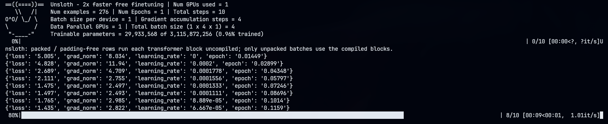

<h1 align="center">AarForge</h1>

<p align="center">
  <b> Your conversational JSONL goes in. Your fine-tuned GGUF model comes out. </b>
</p>

<p align="center">
  <a href="https://github.com/AaritDev/AarForge/">
    
  </a>
  <a href="https://www.python.org/">
    
  </a>
  <a href="https://www.gnu.org/licenses/gpl-3.0">
    
  </a>
  <a href="https://ollama.com/">
    
  </a>
  <a href="https://unsloth.ai/">
    
  </a>
</p>

AarForge is an opinionated local LLM fine-tuning and deployment pipeline that transforms conversational JSONL datasets into fine-tuned GGUF models, ready to run locally with Ollama.

Built around Unsloth, LoRA, 4-bit quantization, and Hugging Face tools, AarForge makes local LLM fine-tuning more accessible on NVIDIA consumer GPUs.

No massive infrastructure. No complicated cloud setup. Just your GPU, your dataset, and a questionable amount of patience.

## Features

- **Automated Setup:** Creates a Python virtual environment and installs the required dependencies.
- **4-bit Fine-tuning:** Uses Unsloth and BitsAndBytes to reduce GPU memory requirements.
- **Conversational JSONL:** Supports OpenAI-style datasets containing `system`, `user`, and `assistant` messages.
- **LoRA Fine-tuning:** Trains lightweight adapters instead of updating the entire base model.
- **GGUF Export:** Merges and exports the fine-tuned model into GGUF format.
- **Ollama Integration:** Automatically generates an Ollama Modelfile and creates a local Ollama model.

## Requirements

- NVIDIA GPU with CUDA support.
- **Recommended:** 6GB or more VRAM (requirements vary depending on the model and configuration).
- Python 3.10 or newer.
- Linux environment with Bash.
- Git or curl.
- Internet connection for downloading dependencies and model weights.
- **At least 45GB of available storage.** This puppy EATS SSDs. In this economy?!

*Actual resource requirements depend on the selected base model, training configuration, and export process.*

## Installation

**1. Clone the repository**

```bash
git clone https://github.com/AaritDev/AarForge.git
cd AarForge
```

**2. Make the installer executable**

```bash
chmod +x install.sh
```

**3. Run the installer**

```bash
./install.sh
```

**4. Choose your workspace**

The installer will ask where you want to create your AarForge workspace.

It will then:

- Install Astral UV if necessary.
- Install Ollama if necessary.
- Create a Python virtual environment.
- Install the required Python dependencies.
- Download the default base model.
- Copy `build.sh` into your workspace.
- Generate a sample conversational dataset.

Once installation finishes, navigate to your selected workspace.

Congratulations! You've just signed up for a long-term relationship with your GPU.

## Dataset Format

AarForge uses **OpenAI-style conversational JSONL**.

Each line in your `.jsonl` file must contain one valid JSON object with a top-level `messages` array.

Every message contains:

- `role`: The message speaker (`system`, `user`, or `assistant`).
- `content`: The message text.

### Example Dataset

```json
{"messages": [{"role": "system", "content": "You are AarBot, a rude and sarcastic AI."}, {"role": "user", "content": "Hello"}, {"role": "assistant", "content": "Oh get lost, I don't care about your hello."}]}
{"messages": [{"role": "system", "content": "You are AarBot, a rude and sarcastic AI."}, {"role": "user", "content": "What is 2 + 2?"}, {"role": "assistant", "content": "Seriously? It's 4. Even a calculator could answer that."}]}
```

### Important Dataset Rules

- Each line represents one independent conversation.
- Each conversation must have its own `messages` array.
- Each conversation can contain its own system prompt.
- Messages must follow the correct conversational order.
- Message content must be a string.
- Every line must contain valid JSON.
- Each conversation must include at least one assistant response.

The system message defines the behavior, personality, and instructions for that particular conversation. User and assistant messages provide the examples used during fine-tuning.

Save your dataset with a `.jsonl` extension.

For example:

```text
my_dataset.jsonl
```

**A small tip:** Quality matters more than quantity. A thousand well-written examples are generally more useful than ten thousand conversations that look like they were generated during a caffeine overdose.

## Usage

**1. Navigate to your AarForge workspace**

```bash
cd /path/to/your/workspace
```

**2. Start the build wizard**

```bash
chmod +x build.sh
./build.sh
```

**3. Configure your model**

The interactive wizard will request the following information:

| Setting | Description |
|---|---|
| Custom AI Name | Name of your Ollama model |
| Dataset Path | Path to your conversational JSONL dataset |
| Base Model ID | Hugging Face or Unsloth base model identifier |
| Training Epochs | Number of passes through the training dataset (1–999999; default: 3) |
| Training Steps | Maximum optimizer steps (0–999999; default: 60; enter 0 to use epochs) |
| System Prompt | System instructions for Ollama inference |
| Temperature | Controls response randomness during inference |

Build settings are saved in `.aarforge-settings.json` in the workspace and reused as the next run's prompt defaults. `install.sh` creates this file with defaults for a new workspace and preserves existing settings.

When both training limits are configured, a positive step count takes precedence over epochs. The default run is therefore 60 steps; enter `0` steps to train for the configured number of epochs.

**4. Wait for training and export**

AarForge automatically handles the following pipeline:

1. Dataset loading and preprocessing.
2. LoRA fine-tuning.
3. Adapter weight saving.
4. GGUF export.
5. Ollama Modelfile generation.
6. Ollama model creation.

Depending on your hardware, model size, and training configuration, this process can take some time.

Go grab a drink. Your GPU has work to do.

<p align="center">
  
</p>

**5. Run your model**

After successful completion:

```bash
ollama run my_custom_bot
```

Replace `my_custom_bot` with your chosen model name.

That's it. Your fine-tuned model is now ready for local inference.

## Project Structure

After installation and a successful build, your workspace will contain files similar to:

```text
AarForge/
├── .venv/
├── build.sh
├── sample_dataset.jsonl
├── my_dataset.jsonl
├── train_bot.py
├── export_gguf.py
├── my_custom_bot_adapter/
├── my_custom_bot_gguf/
└── Modelfile
```

*Generated model directories and filenames depend on your configuration.*

## Technology Stack

AarForge builds on several excellent open-source projects:

- [Unsloth](https://github.com/unslothai/unsloth) — Efficient LLM fine-tuning.
- [Hugging Face Transformers](https://github.com/huggingface/transformers) — Model and tokenizer management.
- [PEFT](https://github.com/huggingface/peft) — Parameter-efficient fine-tuning.
- [BitsAndBytes](https://github.com/bitsandbytes-foundation/bitsandbytes) — 4-bit quantization and quantized model loading.
- [Astral UV](https://github.com/astral-sh/uv) — Fast Python package and environment management.
- [Ollama](https://ollama.com) — Local model deployment and inference.

## Limitations

- Requires an NVIDIA GPU with compatible CUDA support.
- Training performance depends heavily on available VRAM.
- Not every Hugging Face model architecture is necessarily supported.
- GGUF conversion compatibility depends on the selected base model.
- Fine-tuning quality depends on dataset quality and training configuration.

## Acknowledgments

AarForge wouldn't exist without the work of the Unsloth, Hugging Face, and Ollama communities.

A big thank you to everyone building and maintaining the tools that make local AI development possible.

Base models retain their respective licenses and usage restrictions. Make sure to review the applicable model license before using or distributing fine-tuned models.

---

**If you find AarForge useful, consider giving the repository a star!**

It costs you nothing, but it makes me little programmer dopamine receptors go YES.

## LICENSE

> Copyright (C) 2026  Aarit Pandey
> 
> This program is free software: you can redistribute it and/or modify
> it under the terms of the GNU General Public License as published by
> the Free Software Foundation, either version 3 of the License, or
> (at your option) any later version.
